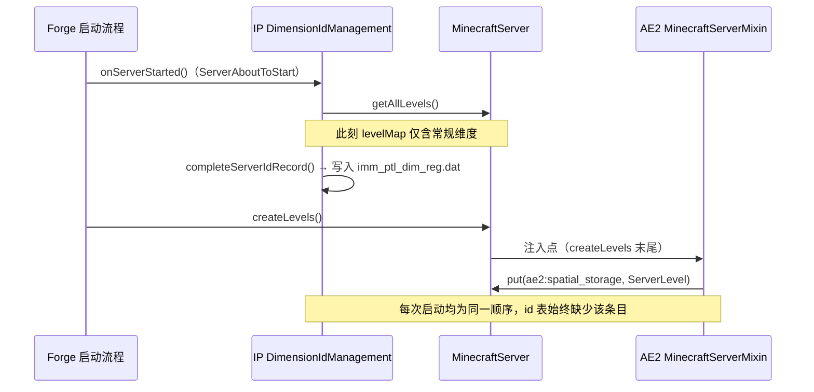
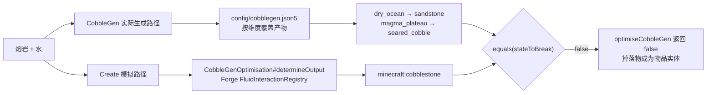

# 技术说明

> 本文记录 `cw_portal_guard` 各修复的根因、实现与实测数据。
> 环境：Minecraft 1.20.1 / Forge 47.4.23 / Immersive Portals 3.0.7。
> 面向使用者概览见 [README](../README.md)。

---

## 1. IP 维度 id 表缺条目

### 现象

```
io.netty.handler.codec.EncoderException: java.lang.RuntimeException: Missing Dimension ae2:spatial_storage
  at qouteall.q_misc_util.dimension.DimensionIdRecord.getIntId(DimensionIdRecord.java:50)
  at qouteall.q_misc_util.dimension.DimId.writeWorldId(DimId.java:25)
  ... ClientboundPlayerPositionPacket.handler$blb000$immersive_portals$onWrite
```

玩家被踢出，服务端生命周期正常，`latest.log` 中该异常可重复出现。

### 根因

`javap -p -c` 核对 Immersive Portals 3.0.7 字节码得到的启动时序：



`completeServerIdRecord()` 遍历 `server.getAllLevels()`（`MinecraftServer.m_129784_()`）并按 `max+1` 分配 id。
AE2 的 `appeng.mixins.spatial.MinecraftServerMixin#injectSpatialLevel` 在 `createLevels` 末尾才把
`ae2:spatial_storage` 加入 levelMap。该顺序在每次启动时保持一致，因此重启后
`imm_ptl_dim_reg.dat` 仍为 90 条且缺少该维度。

> [!NOTE]
> 同类时序适用于所有在 `createLevels` 阶段插入关卡的模组，本修复对它们一并生效。

### 实现

`cw.guard.DimensionRecordGuard` 在 `ServerStartedEvent` 反射调用 Immersive Portals 自身的公开方法：

```java
DimensionIdManagement.updateAndSaveServerDimIdRecord();
// = completeServerIdRecord()
// + recordToTag(serverRecord, dim -> true)
// + NbtIo.writeCompressed(...) → 写入 world/data/imm_ptl_dim_reg.dat
```

id 由 Immersive Portals 按 `max+1` 分配，服务端与客户端使用同一张表。
`ServerStartedEvent` 之后每 20 tick 复查一次，表大小连续 3 次稳定后结束（覆盖关卡懒创建的模组）。
反射调用失败时记录一条日志，服务端继续启动。

### 运维接口

`/cwguard idtable` 遍历 `server.getAllLevels()` 并对每个维度调用
`DimensionIdRecord#getIntId`，输出缺少 id 的维度列表。输出为空表示健康。

### 实测

<details>
<summary>2026-10-31 A/B（测试服）</summary>

基线：把 `imm_ptl_dim_reg.dat` 恢复为缺少条目的 90 条版本。

```
11:49:28  loaded (v1.3.0) side=DEDICATED_SERVER
11:49:28  toggles (...): dimensionIdGuard=true
11:49:57  ServerStartedEvent: 维度表 90 -> 91 条（新增 1）
11:49:57  + 补上维度 id: ae2:spatial_storage -> 89
11:50:08  维度 id 表修复完成：91 条（4 次尝试），ae2:spatial_storage -> 89（已收录）
grep -c "Missing Dimension"  ->  0
/cwguard idtable             ->  dimension id table OK - every loaded dimension has an id
```

真实客户端把玩家传送进 `ae2:spatial_storage` 停留 5 秒再传回，
`grep -c "lost connection"` = 0。

</details>

---

## 2. 首次跨维度门户渲染崩溃

### 现象

```
java.lang.NullPointerException: Cannot invoke
  "net.minecraft.client.renderer.chunk.ChunkRenderDispatcher.m_112693_(net.minecraft.world.phys.Vec3)"
because "this.f_109436_" is null
  at LevelRenderer.handler$com000$immersive_portals$onSetupTerrainBegin(LevelRenderer.java:8349)
```

触发条件：门的目的地被改为本次会话尚未加载过的维度，且玩家正注视该门。
该维度在同一会话内加载过一次后，后续渲染走已初始化路径。

### 根因

`ClientWorldLoader.createSecondaryClientWorld()` 在渲染帧内执行
`new LevelRenderer(...).setLevel(newWorld)`；`setLevel()` 对非空 level 调用 `allChanged()`，
`chunkRenderDispatcher` 与 `ViewArea` 在此方法中创建。Immersive Portals 的
`MixinLevelRenderer.onReloadStarted` 在 `WorldRenderInfo.isRendering()` 时取消 `allChanged()`，
新渲染器保持 `level != null` 且 `chunkRenderDispatcher == null`，
随后 `onSetupTerrainBegin` 无条件调用 `chunkRenderDispatcher.setCamera(...)`。

### 实现

| 组件 | 注入点 / 时机 | 行为 |
|:--|:--|:--|
| `MixinPortalSync` | `Portal#acceptDataSync` RETURN（收包阶段） | 目的地变更后预建该维度的 `ClientLevel` |
| `ClientGuard` | `RenderTickEvent.START`、`ClientTickEvent.END` | 预热已加载门的目的地维度；重新初始化 `chunkRenderDispatcher` 为空的渲染器 |
| `MixinLevelRendererGuard` | `setupRender` HEAD，priority 3000 | 检测到 `chunkRenderDispatcher == null` 时跳过该帧地形构建 |
| `LevelRendererAccessor` | `@Accessor("f_109436_")` | 读取 `chunkRenderDispatcher` |

### 分层验证

分层开关用于定位实际生效的层。每轮测试重启客户端以回到首次渲染路径。

| 仅启用 | 结果 |
|:--|:--|
| 全关 | 崩溃（基线） |
| `portal_sync_prewarm` | 正常，日志 `prewarmed ... (via portal-sync)` |
| `tick_prewarm` | 正常，日志 `(via portal-tick)` |
| `renderer_heal` | 崩溃（自愈晚于异常点） |
| `render_guard` | 正常，日志 `guard skipped terrain setup` |
| 全开 | 正常，无 `guard skipped` |

---

## 3. Configured + JEI 配置菜单崩溃

### 根因

JEI 配置菜单的崩溃报告为 `Ticking screen` / `ListMenuScreen.m_86600_`，前一行日志为
`IllegalStateException: Config schema is inactive: jei`。

链路：JEI 齿轮 → Configured `ModConfigSelectionScreen` → `init()` → `constructEntries()`
→ `JeiConfig.getFileName()` → JEI 15.60+ 的 `IJeiConfigFile#getPath()` 对远程同步、
本地无文件的 schema 抛异常 → `init()` 中断，`searchTextField` 未创建 → 下一 tick 空指针。

### 实现

| 组件 | 行为 |
|:--|:--|
| `ConfiguredJeiMixinPlugin` | `configured` 与 `jei` 同时存在时应用兼容 mixin；`ModList` 未就绪时重新探测；目标类缺失由 `required: false` 处理 |
| `MixinConfiguredConfigMap` | 在 `ClientHandler.createConfigMap` 返回处过滤取文件名会抛异常的配置项 |
| `MixinConfiguredListGuard` | 屏幕半初始化时跳过 tick/render，字段通过反射读取 |

单人 / LAN 场景下服务端配置具备本地文件，条目保持完整显示。

---

## 4. Botania 进度饼 HUD 导致的区块渲染缺失

### 现象

准星指向处于合成状态的符文祭坛时，玩家所在维度的区块层缺失；
门对面维度、实体、方块实体、粒子与 HUD 正常渲染。准星移开后同帧恢复。
客户端进程持续运行，FPS 正常，Embeddium 的 `Geometry Pool` 读数保持非 0。

### 根因

`vazkii.botania.client.core.helper.RenderHelper#renderProgressPie` 的反编译结果：

```
RenderSystem.clear(256, true);                     // glClear(GL_DEPTH_BUFFER_BIT)
GL11.glEnable(2960);                               // GL_STENCIL_TEST
RenderSystem.colorMask(false,false,false,false);
RenderSystem.depthMask(false);
RenderSystem.stencilFunc(512 /*GL_NEVER*/, 1, 255);
RenderSystem.stencilOp(7681, 7680, 7680);
RenderSystem.stencilMask(255);
... 以 stencil 裁剪图标 ...
GL11.glDisable(2960);
```

该方法在 HUD 阶段通过 LWJGL 直接开关 stencil test，并在返回时保留
`stencilFunc` / `stencilOp` / `stencilMask` 的设置值。实测帧首 GL 状态：

```
stencilTest=false depthTest=false blend=false cull=true colorMask=true depthMask=true depthFunc=515
stencilFunc=514(GL_EQUAL) ref=1 valueMask=255 writeMask=0 fail=ZERO zfail=KEEP zpass=KEEP
```

上述 stencil 残值与该方法的设置值逐项吻合；`depthFunc=GL_LEQUAL`、
`colorMask/depthMask=true`、`shaderColor=(1,1,1,1)` 均为中性值。

> [!NOTE]
> 使用该进度饼的其它 Botania 方块（魔力池、泰拉钢平台等）在被注视时具备相同状态输出，
> 本层保护对它们同样生效。

### 实现

`cw.guard.client.GlStateSanitizer` 在 `RenderTickEvent.START`（早于 `LevelRenderer.renderLevel`）
复位以下状态：

| 状态 | 值 |
|:--|:--|
| stencil test | 关闭 |
| `colorMask` / `depthMask` | 全部为 `true` |
| `depthFunc` | `GL_LEQUAL` |
| depth test / cull / blend | 开 / 开 / 关 |
| `shaderColor` | `1, 1, 1, 1` |
| stencil func / op / mask | `GL_ALWAYS` / `GL_KEEP` / `0xFF` |

`colorMask` 与 `depthMask` 采用先设反再设正的写入序列，确保 GL 调用实际下发。
状态探针按每 5 帧抽样，仅在脏状态签名变化时记录一条日志。

### 实测

在配置文件恢复为默认（ImmediatelyFast 通用批处理启用、IP `enableClippingMechanism=true`、
四个门户预热开关关闭）的条件下，祭坛合成 + 准星注视时区块层保持正常渲染，
准星移开与移回均正常。

---

## 5. Create × CobbleGen 产物对齐

### 现象

Create 钻头的刷石机优化（下方为漏斗 / 滑槽 / 传送带时，掉落物直接写入容器）
在部分维度退化为生成物品实体。方块生成与钻头运转正常，日志无异常输出。

### 根因



CobbleGen 5.4.11 通过 `config/cobblegen.json5` 按维度覆盖真实生成产物，
其 `create.CreateFluidReactionsMixin$OFive` / `$PatchE` 与 `fluid.*EventMixin`
作用于流体事件路径。Create 的 `CobbleGenOptimisation#determineOutput` 遍历
Forge `FluidInteractionRegistry`，熔岩 + 水的默认交互返回 `minecraft:cobblestone`。
`DrillBlockEntity#optimiseCobbleGen` 中的 `currentOutput.equals(stateToBreak)`
在产物被覆盖的维度得到 `false`，从而走常规掉落路径。

未被 CobbleGen 配置的维度保持默认圆石，两条路径结果一致。

### 实现

`cw.guard.compat.CobbleGenCompat` 在 `ServerStartedEvent` 向
Forge `FluidInteractionRegistry` 的熔岩交互列表头部插入一条 `InteractionInformation`：

| 阶段 | 行为 |
|:--|:--|
| predicate | 以 Create 的 `CobbleGenLevel` 仿真层运行 `CobbleGen.FLUID_INTERACTION.interact(...)`；`setBlock` 被记录到 `blocksAdded`，产物写入 `ThreadLocal` |
| interaction | 将 `ThreadLocal` 中的产物写入传入的 level（模拟时为仿真层，流体事件时为真实世界） |

Create 的模拟循环采用首个 predicate 命中的条目。CobbleGen 覆盖该维度时，
模拟结果取自 CobbleGen 的判定代码；覆盖未生效时该条目返回 `false`，
循环继续到 Forge 默认条目。

注册表实现使预测与真实生成共用同一份 CobbleGen 判定逻辑。
CobbleGen 后续版本若补全该路径，其计算结果与本条目的结果相同；
`cobblegen_compat=false` 会在 `ServerStartedEvent` 时按引用移除该条目。

### 实测

<details>
<summary>2026-11-06（测试服，Create 6.0.8 / CobbleGen 5.4.11）</summary>

函数级，`determineOutput` 与实际方块：

```
dry_ocean      actual=sandstone       simulated=sandstone       match=true   （修复前 false）
magma_plateau  actual=seared_cobble   simulated=seared_cobble   match=true   （修复前 false）
red_canyon     actual=cobblestone     simulated=cobblestone     match=true
```

端到端，直接调用 `DrillBlockEntity#onBlockBroken`，三个维度：

```
verdict=OPTIMISED (drops went straight into the container, no item entity)   x3
before: container=0 itemEntities=0  ->  after: container=1 (+1) itemEntities=0 (+0)
```

日志：

```
[cw_portal_guard] cobblegen compat installed: own interaction inserted at lava list head
[cw_portal_guard] cobblegen compat active: hexahedron:dry_ocean -> minecraft:sandstone
[cw_portal_guard] cobblegen compat active: hexahedron:magma_plateau -> tconstruct:seared_cobble
```

</details>

---

## 6. 构建与运行约束

### 双端隔离

`mods.toml` 中所有依赖声明为 `side="BOTH"`。客户端代码位于 `cw.guard.client.*`，
由 `@EventBusSubscriber(value = Dist.CLIENT)` 门控；渲染 mixin 位于 mixin 配置的
`"client"` 段。专用服务端的 classpath 中不含 `net.minecraft.client.*`，
上述类在该环境下保持未加载状态。

`ServerStartedEvent` 在单人存档的集成服务端同样触发，修复 1 与 5 在单人模式下执行。

### 构建依赖

`build.sh` 的类路径由本地客户端实例提供：

| 依赖 | 用途 |
|:--|:--|
| `client-*-srg.jar` | Minecraft 类（源码直接使用 SRG 名） |
| `forge-*-universal.jar` / eventbus / fmlcore / fmlloader / javafmllanguage | Forge API |
| `mergetool-*-api.jar` | `net.minecraftforge.api.distmarker.Dist` |
| `lwjgl-opengl` / `lwjgl` | `org.lwjgl.opengl.GL11` |
| `immersive-portals-*.jar`、`configured-forge-*.jar` | 对应修复 |
| `create-*.jar`、`cobblegen-*.jar` | 修复 5 |
| `libs/catnip.jar` | 从 `create` jar 的 jarjar 条目中提取，提供 `WrappedLevel` |

`libs/` 为构建产物，已列入 `.gitignore`。`MC` / `MODS` / `JDK` 支持环境变量覆盖。

### 已知边界

| 项 | 行为 |
|:--|:--|
| 修复 1 的反射目标 | 依赖 IP 的 `updateAndSaveServerDimIdRecord()` 方法名；该方法变更时记录 error 日志，服务端继续启动，可由 `/cwguard idtable` 检出 |
| `ServerStartedEvent` 之前的登录 | 该连接取到旧 id 表，重连后恢复 |
| 修复 5 的反射目标 | 依赖 Forge `FluidInteractionRegistry.INTERACTIONS` 字段及熔岩列表可变；变更时记录 warn 日志，功能退回默认行为 |
| 修复 5 的流体事件路径 | predicate 在真实世界熔岩流动时同样执行，产物取自 CobbleGen 判定代码 |
| `/cwguard repro` | 依赖客户端世界表，仅在单人 / 集成服务端注册 |

### 静态校验

对 `dist/cw_portal_guard-1.4.0.jar` 做过常量池引用扫描：
所有类引用在客户端 classpath（MC srg jar、Forge、Immersive Portals、Configured）
上均可解析。`ClientGuard` 的方法集与 v1.2.0 的 `CwPortalGuard` 一致，
两个 mixin 配置文件与 v1.2.0 逐字节相同。
