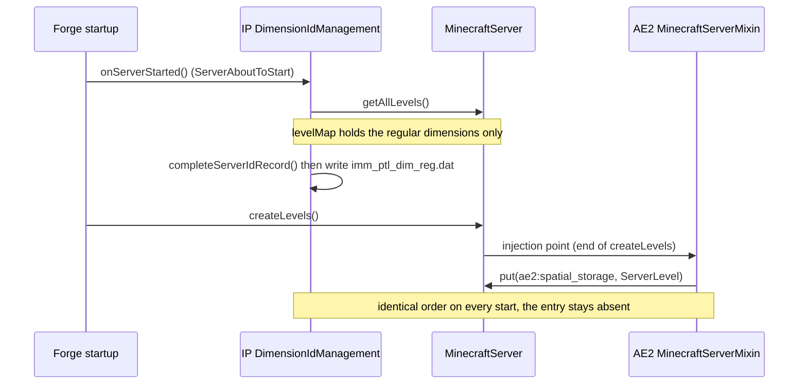
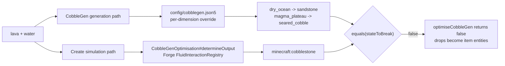

# Technical Notes

**English** | [简体中文](TECHNICAL.zh-CN.md)

> Root causes, implementation and measurements for each fix in `cw_portal_guard`.
> Environment: Minecraft 1.20.1 / Forge 47.4.23 / Immersive Portals 3.0.7.
> For the user-facing overview see [README](../README.md).

---

## 1. Missing entry in the IP dimension-id table

### Symptom

```
io.netty.handler.codec.EncoderException: java.lang.RuntimeException: Missing Dimension ae2:spatial_storage
  at qouteall.q_misc_util.dimension.DimensionIdRecord.getIntId(DimensionIdRecord.java:50)
  at qouteall.q_misc_util.dimension.DimId.writeWorldId(DimId.java:25)
  ... ClientboundPlayerPositionPacket.handler$blb000$immersive_portals$onWrite
```

The player is disconnected. The server lifecycle completes normally and the exception repeats in
`latest.log` on each login attempt.

### Root cause

Startup order derived from the Immersive Portals 3.0.7 bytecode (`javap -p -c`):



`completeServerIdRecord()` iterates `server.getAllLevels()` (`MinecraftServer.m_129784_()`) and
assigns ids with `max+1`. `appeng.mixins.spatial.MinecraftServerMixin#injectSpatialLevel` adds
`ae2:spatial_storage` to levelMap at the end of `createLevels`. This order repeats on every start,
so `imm_ptl_dim_reg.dat` keeps 90 entries and the dimension stays absent after a restart.

> [!NOTE]
> The same ordering affects every mod that inserts a level during `createLevels`.
> This fix covers all of them.

### Implementation

`cw.guard.DimensionRecordGuard` reflectively calls a public Immersive Portals method at
`ServerStartedEvent`:

```java
DimensionIdManagement.updateAndSaveServerDimIdRecord();
// = completeServerIdRecord()
// + recordToTag(serverRecord, dim -> true)
// + NbtIo.writeCompressed(...) -> writes world/data/imm_ptl_dim_reg.dat
```

Ids are assigned by Immersive Portals with `max+1`; server and client share the same table. After
`ServerStartedEvent` the guard re-checks every 20 ticks and stops once the table size has been
stable for 3 consecutive checks, which covers mods that create levels lazily. A failed reflective
call logs one line and the server continues to start.

### Operations interface

`/cwguard idtable` iterates `server.getAllLevels()` and calls `DimensionIdRecord#getIntId` for each
dimension, printing those without an id. Empty output means healthy.

### Measurements

<details>
<summary>2026-10-31 A/B on the test server</summary>

Baseline: `imm_ptl_dim_reg.dat` restored to the 90-entry version missing the dimension.

```
11:49:28  loaded (v1.3.0) side=DEDICATED_SERVER
11:49:28  toggles (...): dimensionIdGuard=true
11:49:57  ServerStartedEvent: table 90 -> 91 entries (+1)
11:49:57  + added dimension id: ae2:spatial_storage -> 89
11:50:08  dimension id repair complete: 91 entries (4 attempts), ae2:spatial_storage -> 89
grep -c "Missing Dimension"  ->  0
/cwguard idtable             ->  dimension id table OK - every loaded dimension has an id
```

A real client was teleported into `ae2:spatial_storage`, held there for 5 seconds and moved back;
`grep -c "lost connection"` = 0.

</details>

---

## 2. Crash on the first cross-dimension portal render

### Symptom

```
java.lang.NullPointerException: Cannot invoke
  "net.minecraft.client.renderer.chunk.ChunkRenderDispatcher.m_112693_(net.minecraft.world.phys.Vec3)"
because "this.f_109436_" is null
  at LevelRenderer.handler$com000$immersive_portals$onSetupTerrainBegin(LevelRenderer.java:8349)
```

Trigger: a portal destination is changed to a dimension that has not been loaded in the current
session, while the player looks at that portal. Once the dimension has been loaded in the session,
later renders take the initialised path.

### Root cause

`ClientWorldLoader.createSecondaryClientWorld()` runs inside the render pass and calls
`new LevelRenderer(...).setLevel(newWorld)`. For a non-null level, `setLevel()` calls `allChanged()`,
which is where `chunkRenderDispatcher` and `ViewArea` are created. Immersive Portals'
`MixinLevelRenderer.onReloadStarted` cancels `allChanged()` while `WorldRenderInfo.isRendering()`
is true, leaving the new renderer with `level != null` and `chunkRenderDispatcher == null`.
`onSetupTerrainBegin` then calls `chunkRenderDispatcher.setCamera(...)` unconditionally.

### Implementation

| Component | Hook / timing | Behaviour |
|:--|:--|:--|
| `MixinPortalSync` | `Portal#acceptDataSync` RETURN (packet handling) | Creates the destination `ClientLevel` as soon as the destination changes |
| `ClientGuard` | `RenderTickEvent.START`, `ClientTickEvent.END` | Prewarms loaded portal destinations; reinitialises renderers whose `chunkRenderDispatcher` is null |
| `MixinLevelRendererGuard` | `setupRender` HEAD, priority 3000 | Skips terrain setup for that frame when `chunkRenderDispatcher` is null |
| `LevelRendererAccessor` | `@Accessor("f_109436_")` | Reads `chunkRenderDispatcher` |

### Layer verification

The switches exist to identify which layer actually applies. Each round restarts the client to
return to the first-render path.

| Only this enabled | Result |
|:--|:--|
| all disabled | crash (baseline) |
| `portal_sync_prewarm` | normal, log `prewarmed ... (via portal-sync)` |
| `tick_prewarm` | normal, log `(via portal-tick)` |
| `renderer_heal` | crash (healing happens after the fault) |
| `render_guard` | normal, log `guard skipped terrain setup` |
| all enabled | normal, no `guard skipped` |

---

## 3. Configured + JEI config-menu crash

### Root cause

The crash report reads `Ticking screen` / `ListMenuScreen.m_86600_`; the preceding log line is
`IllegalStateException: Config schema is inactive: jei`.

Path: JEI config button -> Configured `ModConfigSelectionScreen` -> `init()` -> `constructEntries()`
-> `JeiConfig.getFileName()` -> JEI 15.60+ `IJeiConfigFile#getPath()` throws for a schema synced
from a remote server that has no local file -> `init()` aborts, `searchTextField` is never created
-> null pointer on the next tick.

### Implementation

| Component | Behaviour |
|:--|:--|
| `ConfiguredJeiMixinPlugin` | Applies the compat mixins when both `configured` and `jei` are present; re-probes while `ModList` is unavailable; missing targets are handled by `required: false` |
| `MixinConfiguredConfigMap` | Filters out config entries whose name lookup throws, at `ClientHandler.createConfigMap` RETURN |
| `MixinConfiguredListGuard` | Skips tick/render while the screen is half-initialised; fields are read reflectively |

In single-player and LAN worlds the server config has a local file, so all entries remain visible.

---

## 4. Botania progress-pie HUD breaking chunk rendering

### Symptom

While the crosshair points at a crafting Runic Altar, the chunk layer of the player's own
dimension is missing. The dimension behind a portal, entities, block entities, particles and the
HUD render normally. Moving the crosshair away restores rendering in the same frame. The client
process keeps running, FPS stays normal, and Embeddium's `Geometry Pool` reads non-zero.

### Root cause

Disassembly of `vazkii.botania.client.core.helper.RenderHelper#renderProgressPie`:

```
RenderSystem.clear(256, true);                     // glClear(GL_DEPTH_BUFFER_BIT)
GL11.glEnable(2960);                               // GL_STENCIL_TEST
RenderSystem.colorMask(false,false,false,false);
RenderSystem.depthMask(false);
RenderSystem.stencilFunc(512 /*GL_NEVER*/, 1, 255);
RenderSystem.stencilOp(7681, 7680, 7680);
RenderSystem.stencilMask(255);
... stencil-clipped icon ...
GL11.glDisable(2960);
```

The method toggles the stencil test through LWJGL during the HUD pass and returns with the
`stencilFunc` / `stencilOp` / `stencilMask` values still in place. Measured state at the start of a
frame:

```
stencilTest=false depthTest=false blend=false cull=true colorMask=true depthMask=true depthFunc=515
stencilFunc=514(GL_EQUAL) ref=1 valueMask=255 writeMask=0 fail=ZERO zfail=KEEP zpass=KEEP
```

The stencil values match this method's settings item for item. `depthFunc=GL_LEQUAL`,
`colorMask/depthMask=true` and `shaderColor=(1,1,1,1)` are neutral.

> [!NOTE]
> Other Botania blocks that use the same progress pie (mana pool, terrestrial agglomeration plate)
> produce the same state while being looked at; this layer covers them too.

### Implementation

`cw.guard.client.GlStateSanitizer` resets the following at `RenderTickEvent.START`, before
`LevelRenderer.renderLevel`:

| State | Value |
|:--|:--|
| stencil test | disabled |
| `colorMask` / `depthMask` | all `true` |
| `depthFunc` | `GL_LEQUAL` |
| depth test / cull / blend | on / on / off |
| `shaderColor` | `1, 1, 1, 1` |
| stencil func / op / mask | `GL_ALWAYS` / `GL_KEEP` / `0xFF` |

`colorMask` and `depthMask` are written with an inverted-then-correct sequence so the GL calls
actually reach the driver. The state probe samples every 5 frames and logs one line when the
dirty-state signature changes.

### Measurements

With the config restored to defaults (ImmediatelyFast universal batching enabled, IP
`enableClippingMechanism=true`, the four portal-prewarm switches disabled), the chunk layer stays
correct while the altar crafts and the crosshair rests on it, and moving the crosshair away and
back keeps rendering intact.

---

## 5. Aligning Create and CobbleGen output

### Symptom

Create drills lose the cobble-gen optimisation (drops written straight into a hopper, chute or
belt) in some dimensions and spawn item entities instead. Block generation and drill motion are
normal and the log stays clean.

### Root cause



CobbleGen 5.4.11 overrides the real generated block per dimension through
`config/cobblegen.json5`; its `create.CreateFluidReactionsMixin$OFive` / `$PatchE` and
`fluid.*EventMixin` act on the fluid event path. Create's
`CobbleGenOptimisation#determineOutput` walks Forge's `FluidInteractionRegistry`, where the default
lava + water interaction returns `minecraft:cobblestone`. In dimensions where CobbleGen overrides
the output, `DrillBlockEntity#optimiseCobbleGen` evaluates `currentOutput.equals(stateToBreak)` to
`false` and takes the regular drop path.

Dimensions without a CobbleGen entry keep the default cobblestone, where both paths agree.

### Implementation

`cw.guard.compat.CobbleGenCompat` inserts one `InteractionInformation` at the head of the lava
interaction list in Forge's `FluidInteractionRegistry` during `ServerStartedEvent`:

| Stage | Behaviour |
|:--|:--|
| predicate | Runs `CobbleGen.FLUID_INTERACTION.interact(...)` against a Create `CobbleGenLevel` simulation layer; `setBlock` is recorded into `blocksAdded`, and the product is stored in a `ThreadLocal` |
| interaction | Writes the stored product into the level passed in (the simulation layer during prediction, the real world during fluid events) |

Create's simulation loop takes the first entry whose predicate matches. Where CobbleGen covers the
dimension, the simulated output comes from CobbleGen's own decision code; where it does not, the
entry returns `false` and the loop continues to the Forge default entries.

The registry approach makes prediction and real generation share one CobbleGen decision path. If a
later CobbleGen release completes this path, its computed result equals this entry's result.
Setting `cobblegen_compat=false` removes the entry by reference at `ServerStartedEvent`.

### Measurements

<details>
<summary>2026-11-06 on the test server (Create 6.0.8 / CobbleGen 5.4.11)</summary>

Function level, `determineOutput` against the actual block:

```
dry_ocean      actual=sandstone       simulated=sandstone       match=true   (false before the fix)
magma_plateau  actual=seared_cobble   simulated=seared_cobble   match=true   (false before the fix)
red_canyon     actual=cobblestone     simulated=cobblestone     match=true
```

End to end, calling `DrillBlockEntity#onBlockBroken` directly, three dimensions:

```
verdict=OPTIMISED (drops went straight into the container, no item entity)   x3
before: container=0 itemEntities=0  ->  after: container=1 (+1) itemEntities=0 (+0)
```

Log:

```
[cw_portal_guard] cobblegen compat installed: own interaction inserted at lava list head
[cw_portal_guard] cobblegen compat active: hexahedron:dry_ocean -> minecraft:sandstone
[cw_portal_guard] cobblegen compat active: hexahedron:magma_plateau -> tconstruct:seared_cobble
```

</details>

---

## 6. Build and runtime constraints

### Two-sided isolation

Every dependency in `mods.toml` declares `side="BOTH"`. Client code lives in `cw.guard.client.*` and
is gated by `@EventBusSubscriber(value = Dist.CLIENT)`; render mixins sit in the `"client"` section
of the mixin configuration. A dedicated server's classpath holds no `net.minecraft.client.*`, so
those classes stay unloaded there.

`ServerStartedEvent` also fires on the integrated server of a single-player world, so fixes 1 and 5
run in single-player.

### Build dependencies

`build.sh` takes its classpath from a local client installation:

| Dependency | Purpose |
|:--|:--|
| `client-*-srg.jar` | Minecraft classes (sources use SRG names directly) |
| `forge-*-universal.jar`, eventbus, fmlcore, fmlloader, javafmllanguage | Forge API |
| `mergetool-*-api.jar` | `net.minecraftforge.api.distmarker.Dist` |
| `lwjgl-opengl`, `lwjgl` | `org.lwjgl.opengl.GL11` |
| `immersive-portals-*.jar`, `configured-forge-*.jar` | Corresponding fixes |
| `create-*.jar`, `cobblegen-*.jar` | Fix 5 |
| `libs/catnip.jar` | Extracted from the jarjar entry of the `create` jar; provides `WrappedLevel` |

`libs/` is a build artefact and is listed in `.gitignore`. `MC`, `MODS` and `JDK` accept environment
overrides.

### Known boundaries

| Item | Behaviour |
|:--|:--|
| Fix 1 reflective target | Depends on IP's `updateAndSaveServerDimIdRecord()`. If the method is renamed, one error line is logged, the server continues to start, and `/cwguard idtable` reports it |
| Login before `ServerStartedEvent` | That connection reads the previous id table and recovers on reconnect |
| Fix 5 reflective target | Depends on the Forge `FluidInteractionRegistry.INTERACTIONS` field and a mutable lava list. If either changes, one warn line is logged and the behaviour falls back to the default |
| Fix 5 fluid event path | The predicate also runs during real-world lava flow; the product comes from CobbleGen's decision code |
| `/cwguard repro` | Relies on the client world table and is registered in single-player / integrated server only |

### Static verification

A constant-pool reference scan of `dist/cw_portal_guard-1.4.0.jar` resolves every class reference
against the client classpath (MC srg jar, Forge, Immersive Portals, Configured). The `ClientGuard`
method set matches `CwPortalGuard` from v1.2.0, and both mixin configuration files are
byte-identical to v1.2.0.
